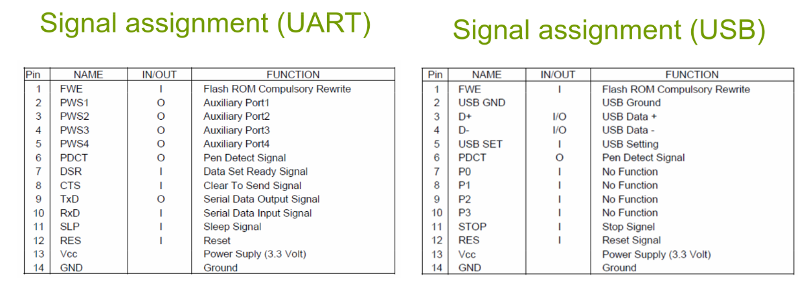

# WACOM-ThinkPad-X60T-Digitizer

It works!  [Youtube link](https://youtu.be/RoAJn2lIkPo)


This project is an unofficial interoperability implementation for legacy ISDV4-compatible EMR panel.

Wacom is a trademark of Wacom Co., Ltd.

## Hardware part.

### What you need:
- USB <-> UART converter, wich support 3.3V (I used CH343);
- Wires or connector with wires;
- Digitizer module with coil array (I used SU-1208E-01X).

### How co connect:
1. All connecions on connector CN1.
```
Pin 14 - GND
Pin 13 - 3.3V
Pin 10 - UART TX
Pin 9 - UART RX
```
Connector pinout:




2. Disconnect or cut UART lines from chip of resistive touchpanel (or just desolder GUNZE AHL-71N chip), because it can cause bug with teleporting cursor even it set up properly:


It's all.

Thanks for ```Mystic-X``` from [thinkpad-forum.de](https://thinkpad-forum.de/threads/wacom-digitizer-aus-x6-tablet-etwas-analysiert.159569/) and [linuxwacom documentation of ISDV4 Protocol](https://github.com/linuxwacom/input-wacom/wiki/For-Developers:-ISDV4-Protocol)! 


## How to use
You can just flash the ESP32-S3 SuperMini firmware from [here](https://github.com/bulat-chu/WACOM-ThinkPad-X60T-Digitizer/tree/main/code)

Or use the python script.

Dependencies (for ArchLinux): ```python-pyserial``` and ```python-evdev```
```
sudo pacman -S python-pyserial python-evdev
```
Load ```uinput``` module:
```
sudo modprobe uinput
```

Add yourself to ```uucp``` group:
```
sudo usermod -aG uucp $USER
```
And run (check rights if couldn't execute):
```
sudo python ./wacom_tp_SU-1208E-01X_Serial.py
```
